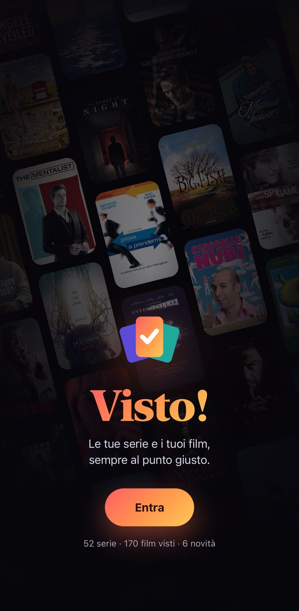
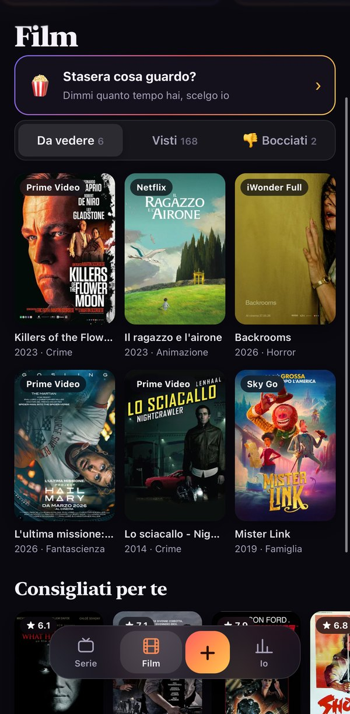
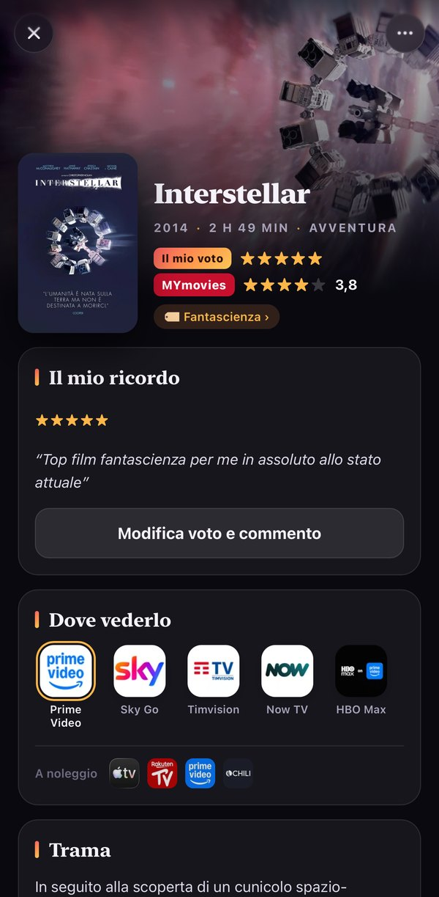
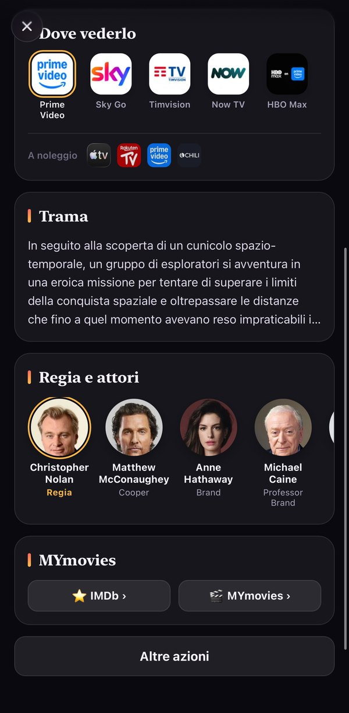
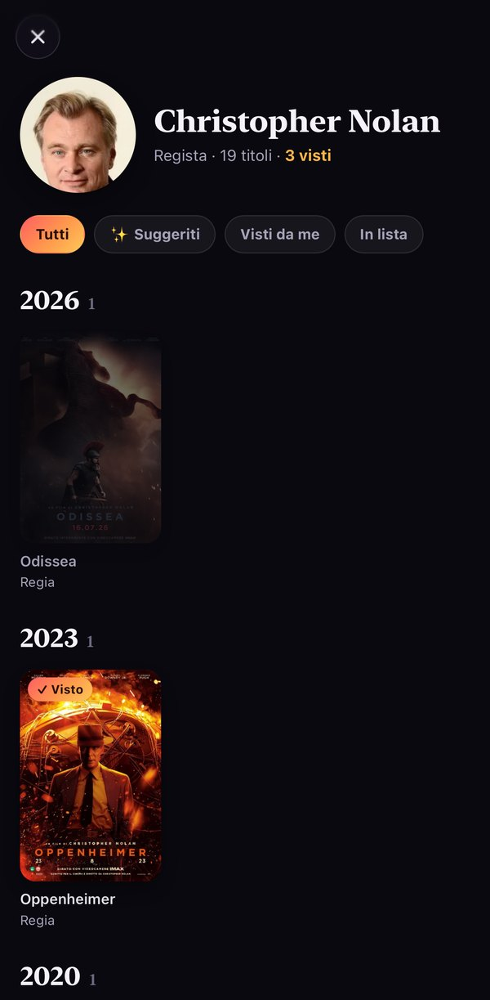
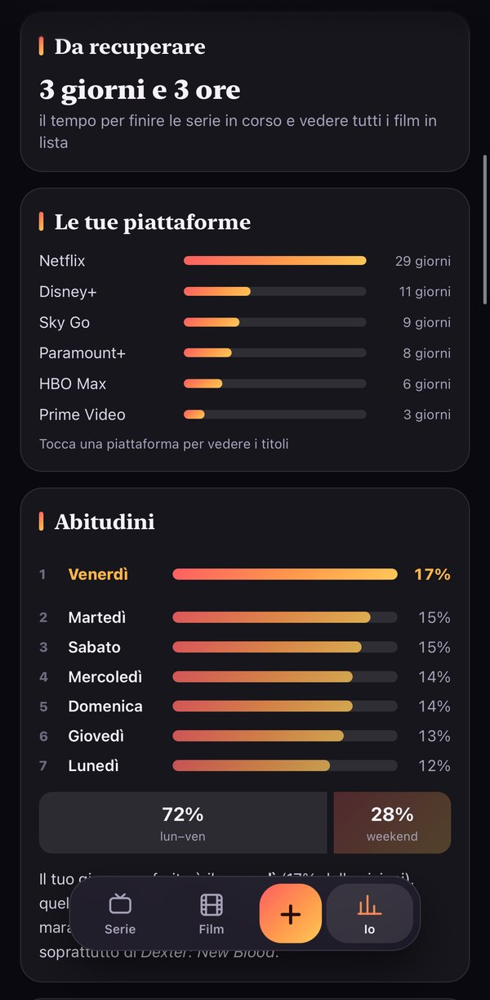
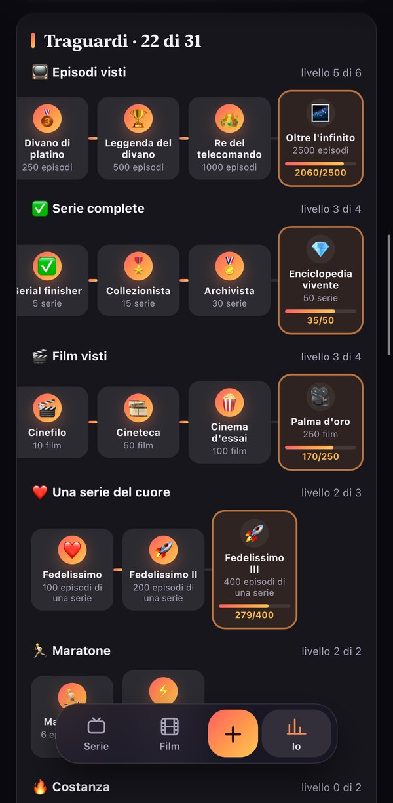

  

<h1 align="center">Visto!</h1>

  <em>Il tuo diario di serie TV e film. Elegante, semplice, tutto tuo.</em>

  <a href="https://stich130476.github.io/visto/"><b>▶ Apri Visto!</b></a>

---

<table align="center">
  <tr>
    <td align="center"> <b>L'intro</b> con le tue locandine</td>
    <td align="center"> <b>Serie</b>: novità e prossimo episodio</td>
    <td align="center"> <b>Film</b>: da vedere e dove trovarli</td>
  </tr>
  <tr>
    <td align="center"> <b>La scheda</b>: voto, ricordo, piattaforme</td>
    <td align="center"> <b>Trama, regia e attori</b></td>
    <td align="center"> <b>Registi e attori</b>: tutta la filmografia</td>
  </tr>
  <tr>
    <td align="center"> <b>Io</b>: il tuo divano, in numeri</td>
    <td align="center"> <b>Piattaforme e abitudini</b></td>
    <td align="center"> <b>Traguardi</b> da sbloccare</td>
  </tr>
</table>

---

## Cos'è

**Visto!** è un'app per ricordarti sempre dove sei arrivato con le serie TV e quali film hai visto o vuoi vedere.
Si apre dal browser e si installa sulla schermata Home di iPhone e iPad come una vera app. Non serve nessun App Store, non costa niente e non ha pubblicità.

## Cosa sa fare

- 📺 **Serie TV**: spunti gli episodi visti stagione per stagione e sai subito qual è il prossimo.
- 🎬 **Film**: una lista "da vedere" e un diario dei film visti, con voto e commento personale per ricordarti com'erano.
- 🆕 **Novità**: nuove stagioni e nuovi episodi delle tue serie compaiono in cima, anche se riapri l'app dopo mesi.
- 🍿 **Stasera cosa guardo?**: un suggerimento al volo tra le piattaforme di streaming.
- ✨ **Consigliati per te**: proposte basate sui tuoi gusti.
- 🏆 **Traguardi** e **Il mio anno in Visto!**: le tue statistiche e i tuoi generi preferiti.
- 📥 **Importa da Netflix**: porti dentro la tua cronologia in pochi passaggi.
- 🎭 **Registi e attori**: tocchi un nome e vedi tutta la sua filmografia, con quello che hai già visto.
- 📊 **Statistiche**: generi preferiti, piattaforme più usate, giorni della settimana davanti allo schermo.
- 🌙 **Modalità notte e giorno**, con locandine scelte in automatico.

## Come installarla sull'iPhone o sull'iPad

1. Apri **[stich130476.github.io/visto](https://stich130476.github.io/visto/)** con **Safari**.
2. Tocca il pulsante **Condividi** (il quadrato con la freccia verso l'alto).
3. Scegli **Aggiungi alla schermata Home** e conferma.

Fatto: Visto! è sulla Home con la sua icona e si apre a tutto schermo.

> Funziona anche dal computer: basta aprire lo stesso indirizzo in qualsiasi browser.

## Primo avvio

- **Serie TV**: funzionano subito, senza configurare niente.
- **Film**: serve una chiave gratuita di **TMDB**. Crea un account su [themoviedb.org](https://www.themoviedb.org/), vai in *Impostazioni → API* e copia la chiave in **Visto! → Impostazioni → Chiave TMDB**.

## I tuoi dati sono tuoi

Tutto quello che inserisci resta **nel tuo dispositivo**. Visto! non ha un server, non raccoglie dati e non ti chiede nessun account.
Chi vuole può anche sincronizzare iPhone, iPad e computer e ricevere le notifiche delle nuove puntate, usando un proprio repository privato su GitHub. È facoltativo e pensato per utenti un po' esperti: l'app funziona benissimo anche senza.

## Ringraziamenti

Dati delle serie da [TVmaze](https://www.tvmaze.com/), dati e locandine dei film da [TMDB](https://www.themoviedb.org/).
This product uses the TMDB API but is not endorsed or certified by TMDB.

---

  Creata con 🖤💙 da <b>Stefano Fasolato</b>

