

  

<h1 align="center">Visto!</h1>

  <em>Il tuo diario di serie TV e film. Elegante, semplice, tutto tuo.</em>

  <a href="https://stich130476.github.io/visto/"><b>▶ Apri Visto!</b></a>

---

<table align="center">
  <tr>
    <td align="center"> <b>L'intro</b> con le tue locandine</td>
    <td align="center">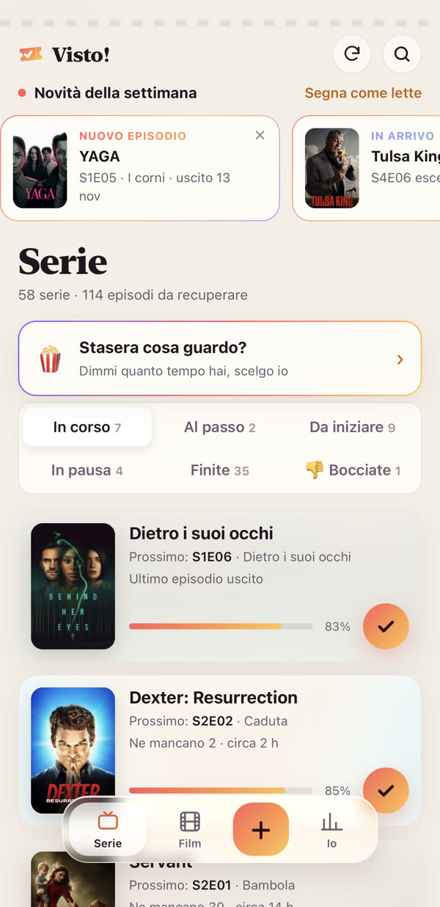 <b>Serie</b>: novità e prossimo episodio</td>
    <td align="center"> <b>Film</b>: da vedere e dove trovarli</td>
  </tr>
  <tr>
    <td align="center"> <b>La scheda</b>: voti e piattaforme</td>
    <td align="center">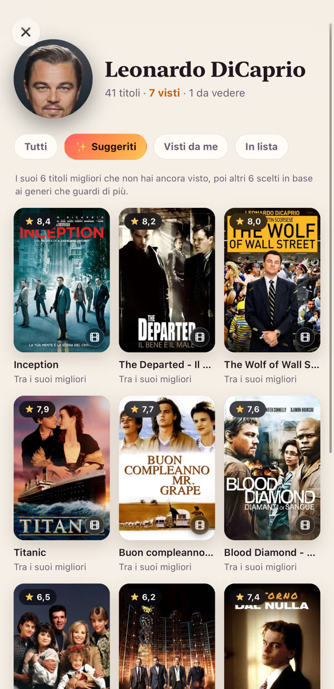 <b>Attori e registi</b>: i loro titoli migliori per te</td>
    <td align="center">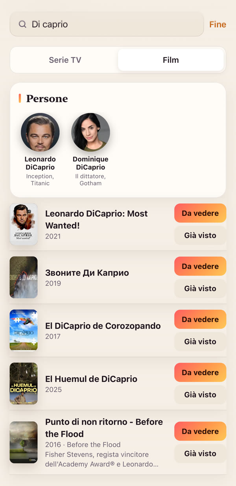 <b>Cerca</b> serie, film e persone</td>
  </tr>
  <tr>
    <td align="center">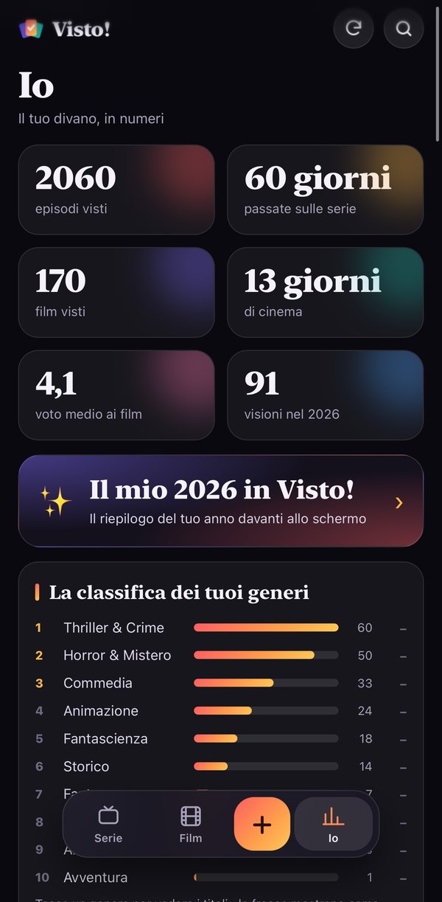 <b>Io</b>: il tuo divano, in numeri</td>
    <td align="center">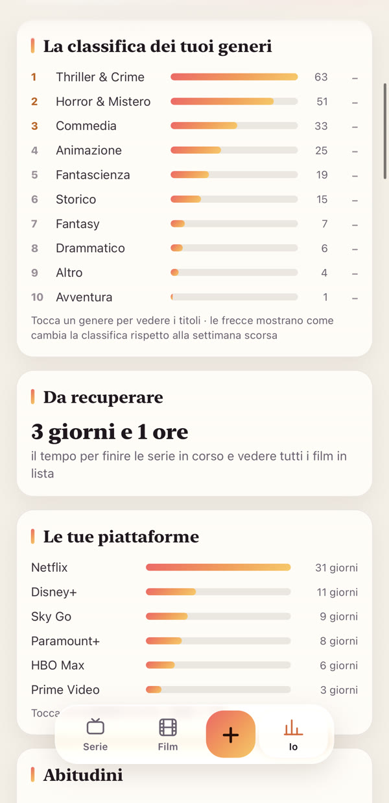 <b>I tuoi generi</b> e le tue piattaforme</td>
    <td align="center"> <b>Traguardi</b> da sbloccare</td>
  </tr>
  <tr>
    <td align="center">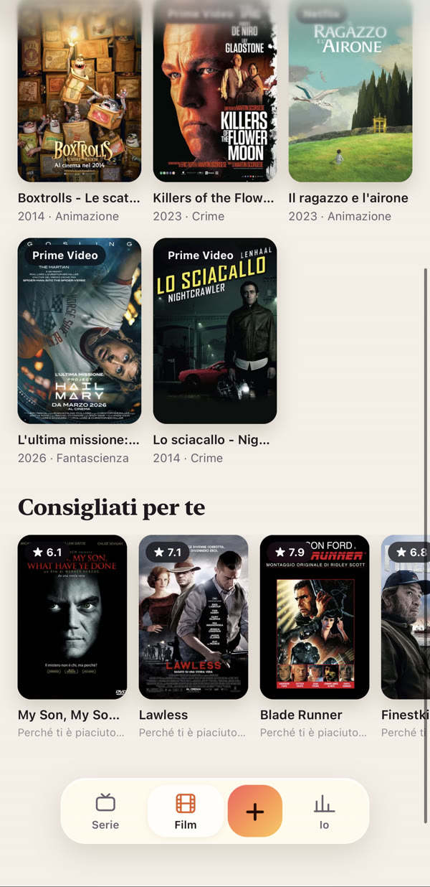 <b>Consigliati per te</b></td>
    <td align="center">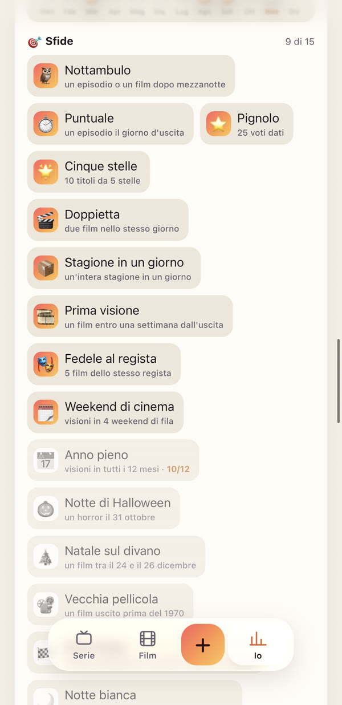 <b>Sfide</b> fisse e del mese</td>
    <td align="center">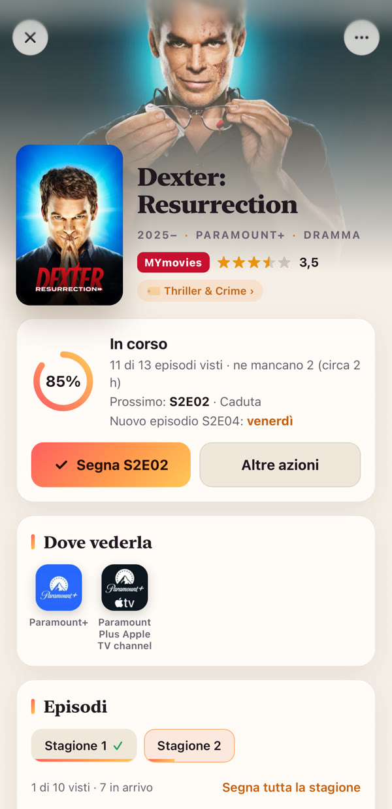 <b>La scheda della serie</b>: episodi e prossima uscita</td>
  </tr>
</table>

<h3 align="center">Su iPad, di notte</h3>

<table align="center">
  <tr>
    <td align="center">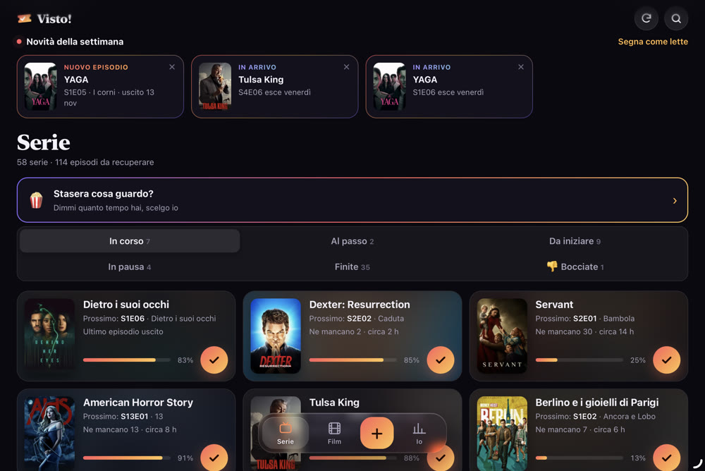 <b>Serie</b></td>
    <td align="center">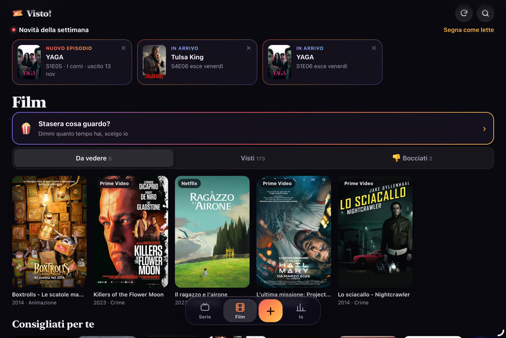 <b>Film</b></td>
  </tr>
  <tr>
    <td align="center">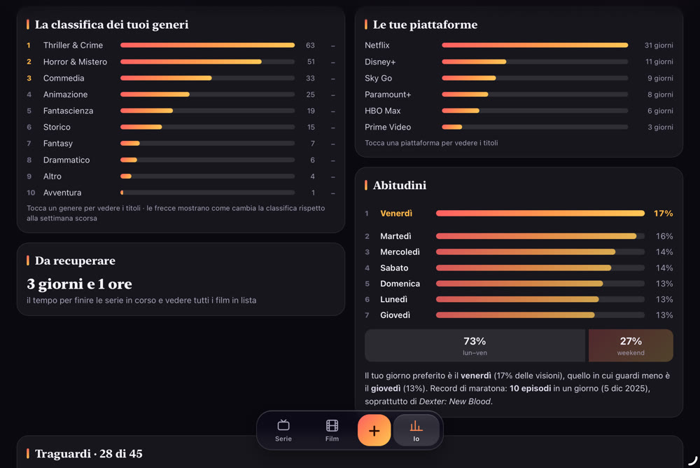 <b>Generi, piattaforme e abitudini</b></td>
    <td align="center">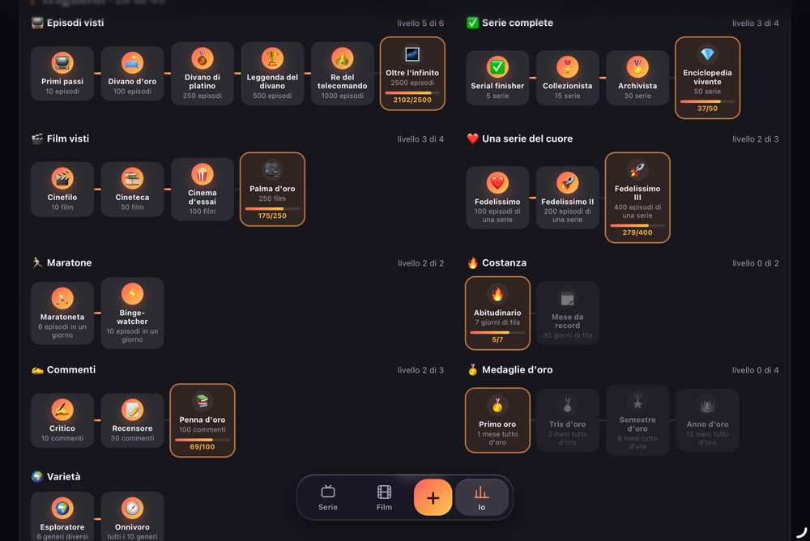 <b>Traguardi</b></td>
  </tr>
</table>

---

## Cos'è

**Visto!** è un'app per ricordarti sempre dove sei arrivato con le serie TV e quali film hai visto o vuoi vedere.
Si apre dal browser e si installa sulla schermata Home di iPhone, iPad e Android come una vera app. Non serve nessun App Store, non costa niente e non ha pubblicità.

## Cosa sa fare

- 📺 **Serie TV**: spunti gli episodi visti stagione per stagione e sai subito qual è il prossimo.
- 🎬 **Film**: una lista "da vedere" e un diario dei film visti, con voto e commento personale per ricordarti com'erano.
- 🆕 **Novità**: nuove stagioni e nuovi episodi delle tue serie compaiono in cima, anche se riapri l'app dopo mesi.
- 🔔 **Notifiche**, anche ad app chiusa, su iPhone, Apple Watch e Android:
  - è uscito un **nuovo episodio** di una serie che segui;
  - arriva una **nuova stagione**;
  - **torna** una serie che avevi finito o messo in pausa;
  - esce al cinema o in streaming un **film della tua lista**.
- 🍿 **Stasera cosa guardo?**: un suggerimento al volo tra le piattaforme di streaming.
- ✨ **Consigliati per te**: proposte basate sui tuoi gusti.
- 🏆 **Traguardi**, **sfide del mese** e **medaglie**, più **Il mio anno in Visto!** con le tue statistiche.
- 🎁 **Sfide a sorpresa**: il 1° di ogni mese ne arriva una nuova. Quale? Lo scopri solo quel giorno.
- 📥 **Importa da Netflix**: porti dentro la tua cronologia in pochi passaggi.
- 🎭 **Registi e attori**: tocchi un nome e vedi data e luogo di nascita (e di morte), con l'età, e tutta la sua filmografia, con quello che hai già visto e un'icona che distingue serie e film. Nei **Suggeriti** trovi prima i suoi titoli migliori, poi quelli più vicini ai tuoi generi.
- 🔎 **Ricerca**: serie, film e persone. Per i film con lo stesso titolo basta aggiungere l'anno (es. *Nosferatu 1922*).
- 📊 **Statistiche**: generi preferiti, piattaforme più usate, giorni della settimana davanti allo schermo.
- 🎵 **Colonne sonore**: nella scheda di ogni film e serie trovi l'album ufficiale con tutti i brani (da MusicBrainz). Tocchi un brano e si apre nella tua **app di musica** — Spotify, Apple Music, YouTube Music, Amazon Music o Deezer, la scegli in Impostazioni. E con **Tutte le canzoni del film** vai su Tunefind, dove ci sono anche i brani scelti per le singole scene.
- 📅 **Date delle serie**: quando hai iniziato e finito ogni stagione e la serie intera, calcolate da sole dagli episodi che spunti.
- 🌙 **Modalità notte e giorno**, con locandine scelte in automatico.

## Come installarla sull'iPhone o sull'iPad

1. Apri **[stich130476.github.io/visto](https://stich130476.github.io/visto/)** con **Safari**.
2. Tocca il pulsante **Condividi** (il quadrato con la freccia verso l'alto).
3. Scegli **Aggiungi alla schermata Home** e conferma.

Fatto: Visto! è sulla Home con la sua icona e si apre a tutto schermo.

## Su Android

1. Apri **[stich130476.github.io/visto](https://stich130476.github.io/visto/)** con **Chrome**.
2. Tocca il menu **⋮** in alto a destra.
3. Scegli **Aggiungi a schermata Home** (o **Installa app**) e conferma.

> Funziona anche dal computer: basta aprire lo stesso indirizzo in qualsiasi browser. Lì puoi usare anche la tastiera: **Esc** chiude, **/** o **Ctrl+K** cerca, **1 2 3** passano a Serie, Film e Io.

## Primo avvio

- **Serie TV**: funzionano subito, senza configurare niente.
- **Film**: serve una chiave gratuita di **TMDB**. Crea un account su [themoviedb.org](https://www.themoviedb.org/), vai in *Impostazioni → API* e copia la chiave in **Visto! → Impostazioni → Chiave TMDB**. Va bene sia la **API Key** (corta) sia il **Read Access Token** (lungo).
- **Modalità archivio**: all'inizio è accesa. Serve mentre inserisci serie e film visti **in passato**, così non falsano le statistiche di oggi. Quando hai finito, spegnila in **Io → Impostazioni**: da lì in poi ogni cosa che segni conta con la sua data.

## I tuoi dati sono tuoi

Tutto quello che inserisci resta **nel tuo dispositivo**. Puoi sempre salvarne una copia con **Io → Backup → Salva sul telefono**. Visto! non ha un server, non raccoglie dati e non ti chiede nessun account.
Chi vuole può anche sincronizzare tutti i suoi dispositivi, ricevere le notifiche, avere i voti MYmovies e un **backup automatico ogni notte**, usando un proprio **repository privato su GitHub** (gratuito). È facoltativo: l'app funziona benissimo anche senza. Come fare è spiegato qui sotto.

## Sincronizzazione, notifiche e voti: passo passo

Serve un account gratuito su [GitHub](https://github.com). Si fa una volta sola, in una decina di minuti.

**1. Crea il repository dei dati**
Vai su [github.com/new](https://github.com/new), scrivi come nome `visto-dati`, scegli **Private**, spunta **Add a README file** e premi **Create repository**.

**2. Crea la chiave**
Vai su [github.com/settings/personal-access-tokens/new](https://github.com/settings/personal-access-tokens/new):
- *Token name*: `Visto`; *Expiration*: la durata più lunga che ti propone;
- *Repository access*: **Only select repositories** → `visto-dati`;
- *Permissions → Repository permissions*: **Contents**, **Actions** e **Workflows** su **Read and write**.

Premi **Generate token** e copia la chiave (comincia con `github_pat_`). GitHub te la mostra una volta sola.

**3. Collega Visto!**
In **Visto! → Io → Impostazioni → Sincronizzazione tra dispositivi** scrivi il tuo nome utente GitHub, `visto-dati` e la chiave, poi premi **Salva e sincronizza**.

**4. Prepara gli automatismi**
Subito sotto compare **⚙️ Automatismi su GitHub**: premi **Prepara**. Visto! copia nel tuo repository i file per notifiche, voti e backup (li trovi in [`modello-dati`](modello-dati/)) e crea le chiavi delle notifiche. Ci vogliono un paio di minuti.

**5. Attiva le notifiche**
Apri Visto! **dall'icona sulla schermata Home** e in **Impostazioni → Notifiche** premi **Attiva**. Dopo un paio di minuti arriva la notifica di benvenuto.

**6. Gli altri dispositivi**
Sul primo dispositivo premi **📋 Copia le chiavi** (in Sincronizzazione), mandatele (per esempio con un messaggio a te stesso) e sull'altro premi **📥 Incolla le chiavi**. Poi attiva le notifiche anche lì.

> Il backup notturno ha un controllo di sicurezza: se un giorno i dati sembrano rovinati (illeggibili o con molti titoli in meno), il backup buono non viene toccato e GitHub ti avvisa con un'email.

> La chiave resta solo sui tuoi dispositivi e nel tuo repository: Visto! non ha un server e nessun altro la vede. Gli automatismi usano i minuti gratuiti di GitHub Actions, più che sufficienti.

## Ringraziamenti

- Serie ed episodi: [TVmaze](https://www.tvmaze.com/) (licenza CC BY-SA).
- Film, attori, registi e locandine: [TMDB](https://www.themoviedb.org/).
- Dove vedere film e serie: [JustWatch](https://www.justwatch.com/), tramite TMDB.
- Colonne sonore: [MusicBrainz](https://musicbrainz.org/).
- Tutte le canzoni delle scene: [Tunefind](https://www.tunefind.com/).
- Voti: [MYmovies](https://www.mymovies.it/) e [IMDb](https://www.imdb.com/).

This product uses the TMDB API but is not endorsed or certified by TMDB.

---

  🖤💙 <i>Stefano Fasolato</i>

